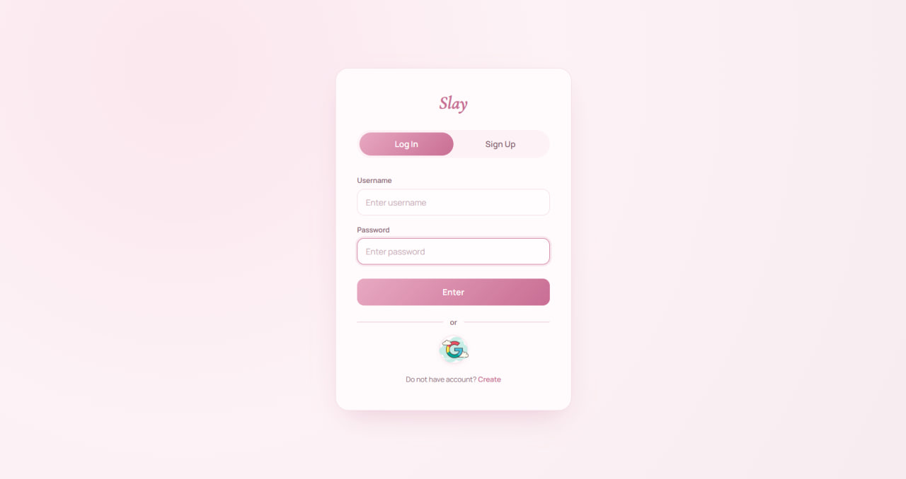
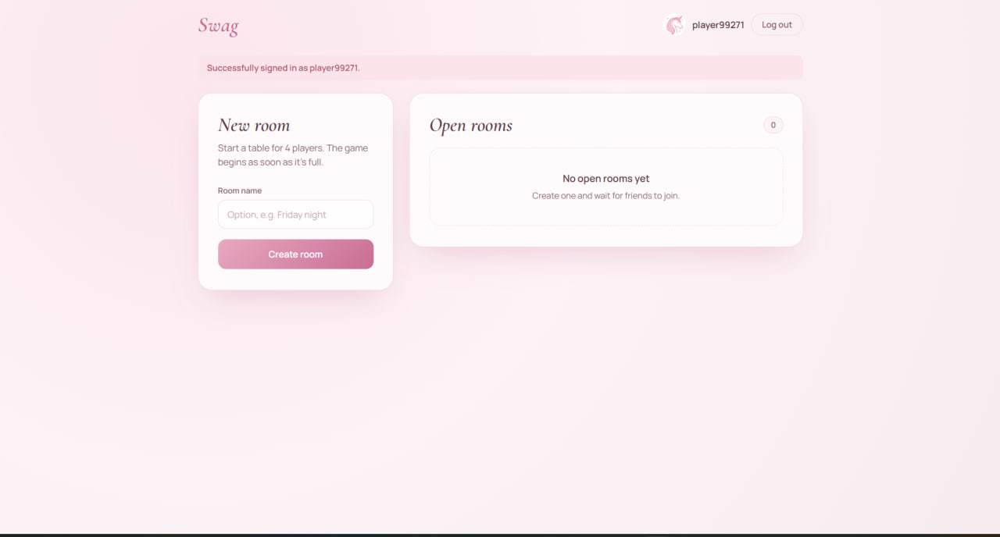
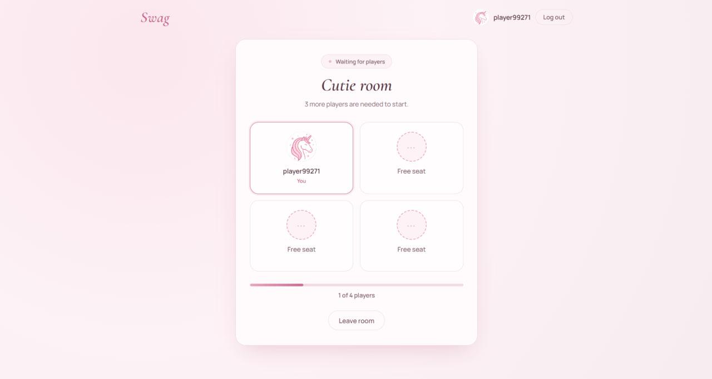

# Slay · Online Texas Hold'em

A real-time multiplayer **Texas Hold'em** game for **4 players**, built with Django and WebSockets.
Create or join a room, wait in a waiting room until four players are seated, and the game starts automatically.

> **Live demo:** none at the moment. You can run the project locally or deploy your own copy to Render in a few minutes (see [Deploy to Render](#deploy-to-render)).





## Table of contents

- [Features](#features)
- [Tech stack](#tech-stack)
- [Project structure](#project-structure)
- [How it works](#how-it-works)
- [Game rules](#game-rules)
- [Run locally](#run-locally)
- [Run with Docker](#run-with-docker)
- [Configuration](#configuration)
- [Google sign-in](#google-sign-in)
- [Deploy to Render](#deploy-to-render)

## Features

- **Accounts:** log in and sign up on one page or continue with Google
- **Lobby:** a live list of open rooms, create your own room, one click to join
- **Waiting room:** see who has joined, the game starts with a 3-2-1 countdown when the fourth player arrives
- **Real-time poker table:** no-limit Texas Hold'em over WebSockets. Fold, check, call, raise with a slider and presets (min, ½ pot, pot, all-in).
- **Complete rules:** blinds, betting rounds, side pots, all-in runouts, split pots, showdown. The strongest hand is evaluated by the [`treys`](https://github.com/ihendley/treys) library
- **Fair by design:** the server decides everything and never sends you your opponents' hidden cards before showdown
- **Turn timer:** 30 seconds per move. If time runs out the player is checked or folded automatically
- **Leaving the table counts as a loss:** you lose your chips, your hand is folded and nobody waits for you
- **Blinds go up** every 8 hands, so every game ends
- **Design:** pink, plum and a lot of attitude. Slay-approved for queens, kings and everyone

## Tech stack

| Part | Technology |
| --- | --- |
| Backend | Django 5.2 |
| Real-time | Django Channels 4 + Daphne (ASGI) |
| Google sign-in | django-allauth (Google OAuth 2.0) |
| Database | PostgreSQL (Docker / production), SQLite (local development) |
| Message broker | Redis via `channels-redis` (Docker / production), in-memory layer locally |
| Hand evaluation | `treys` |
| Static files | WhiteNoise |
| Frontend | Django templates, vanilla JavaScript and CSS |
| Packaging | Docker, Docker Compose, Render Blueprint (`render.yaml`) |

## Project structure

```
holdem_poker/
├── core/               # settings, root URLs, ASGI entry point (HTTP + WebSocket routing)
├── lobby/              # rooms: lobby page, create / join / leave, waiting room
├── game/               # the poker game
│   ├── engine.py       #   rules, betting, side pots, showdown (StateMachine)
│   ├── consumers.py    #   WebSocket consumer: receives actions, broadcasts state
├── (authent)           # login and sign-up page
├── Dockerfile
├── docker-compose.yml  # web + PostgreSQL + Redis for local Docker runs
├── render.yaml         # one-file deployment to Render
├── requirements.txt
└── .env.example
```

## How it works

1. **Auth page** (`/`) logs the user in and redirects to the lobby
2. **Lobby** (`/lobby/`) shows open rooms. The page polls a small JSON endpoint every few seconds
3. **Waiting room** (`/lobby/rooms/<id>/`) polls its state every 2 seconds. Each poll is also a heartbeat: players who disappear for 30 seconds are removed from waiting rooms, and empty rooms are deleted
4. When the 4th player joins, the room status becomes `playing` and everybody is redirected to **the table** (`/game/<id>/`)
5. The table opens a WebSocket (`/ws/game/<id>/`). The browser only sends intentions (`action`, `timeout`, `next_hand`). The server validates every one of them in `engine.py`and saves the new state and broadcasts it to the room
6. Each player gets a personalised view of the state


## Game rules

| Setting | Value |
| --- | --- |
| Players | 4 |
| Starting chips | 1,000 each (4,000 in play, so the pot can never exceed 4,000) |
| Blinds | 10 / 20, doubling every 8 hands |
| Betting | No-limit: any raise from the minimum up to all your chips |
| Turn time | 30 seconds, then auto check or fold |
| Pause after showdown | 9 seconds (5 seconds if everyone else folded) |
| Game ends | when one player holds all the chips |

Notes:
- Ties split the pot; an odd chip goes to the first winner left of the dealer
- A short all-in raise does not change the minimum raise (small simplification: other players may still re-raise)
- Closing the tab is not the same as leaving: your seat stays and folds automatically on timeouts, so you can reconnect

## Run locally

Requirements: Python 3.11+.

```bash
# 1. create and activate a virtual environment
python -m venv venv
venv\Scripts\activate          # Windows (PowerShell)
# source venv/bin/activate     # macOS / Linux

# 2. install dependencies
python -m pip install -r requirements.txt

# 3. create the database tables
python manage.py migrate

# 4. start the server
python manage.py runserver
```

Open <http://127.0.0.1:8000/>, sign up and create a room.

Locally the project uses SQLite and an in-memory channel layer, so no extra services are needed.


## Run with Docker

Requirements: Docker Desktop

```bash
# 1. create your settings file and edit the secret values inside
cp .env.example .env            # PowerShell: Copy-Item .env.example .env

# 2. build and start web + PostgreSQL + Redis
docker compose up --build
```

Open <http://localhost:8000/>. The app applies migrations and collects static files by itself on startup.

Useful commands:

```bash
docker compose down                       # stop (the database is kept)
docker compose down -v                    # stop and delete the database
```

## Configuration

All settings come from environment variables. For Docker put them in `.env` (copied from `.env.example`).

| Variable | Purpose | Default |
| --- | --- | --- |
| `DJANGO_SECRET_KEY` | Django secret key. Always set your own in production | insecure dev key |
| `DJANGO_DEBUG` | `1` for debug mode, `0` for production | `0` |
| `DJANGO_ALLOWED_HOSTS` | comma-separated host names | `localhost,127.0.0.1` |
| `DJANGO_CSRF_TRUSTED_ORIGINS` | comma-separated origins with scheme, needed for a real HTTPS domain | empty |
| `DATABASE_URL` | full PostgreSQL connection string (used by Render) | - |
| `POSTGRES_DB`, `POSTGRES_USER`, `POSTGRES_PASSWORD`, `POSTGRES_HOST`, `POSTGRES_PORT` | PostgreSQL settings (used by Docker Compose) | - |
| `REDIS_URL` | Redis address for the channel layer | - |
| `PORT` | port the server listens on | `8000` |
| `RENDER_EXTERNAL_HOSTNAME` | set automatically by Render, added to allowed hosts | - |
| `GOOGLE_CLIENT_ID`, `GOOGLE_CLIENT_SECRET` | OAuth client from Google Cloud Console. Without them the Google button is hodden | - |


## Google sign-in

Login with Google is optional and works the same locally, in Docker and on Render. It is built with django-allauth.

1. In the [`Google Cloud Console`](https://console.cloud.google.com/) create a project, set up the **Google Auth Platform** (app name, support e-mail) and create an **OAuth client** of type **Web application**.
2. Add every address your site runs on as an **Authorized redirect URI** (the path is always /accounts/google/login/callback/):
    - http://localhost:8000/accounts/google/login/callback/
    - http://127.0.0.1:8000/accounts/google/login/callback/
    - https://YOUR-SERVICE.onrender.com/accounts/google/login/callback/ (your real Render address)
3. Copy the **Client ID** and **Client secret** (the secret is shown only once) and provide them as the environment variables `GOOGLE_CLIENT_ID` and `GOOGLE_CLIENT_SECRET`:
    - Docker: write them into .env.
    - Local without Docker (PowerShell): $env:GOOGLE_CLIENT_ID="..." and $env:GOOGLE_CLIENT_SECRET="..." before python manage.py runserver.
    - Render: add them in the service's **Environment** tab.
4. While the OAuth consent screen is in *Testing mode*, only the test users you list there can sign in.

Accounts created through Google get a neutral nickname (`player04817`), because usernames are visible to other players. If a Google account uses an e-mail that already belongs to a username and password account, the two are intentionally **not** merged automatically (this prevents account takeover).


## Deploy to Render

The repository contains a **Blueprint** file, `render.yaml`. It describes the whole setup, so Render can create everything for you:

- `holdem-db`: a PostgreSQL database
- `holdem-redis`: a Redis (Key Value) instance
- `holdem-poker`: the web service, built from the `Dockerfile`

Steps:

1. Push the project to a GitHub repository (the `.gitignore` keeps `venv/`, `.env` and `db.sqlite3` out)
2. Create an account on [render.com](https://render.com) and connect your GitHub account
3. In the dashboard choose **New → Blueprint**, select your repository and click **Apply**
4. Wait for the build. When the logs show that Daphne is listening, open the address shown on the `holdem-poker` service page

The secret key and the database and Redis addresses are filled in automatically

